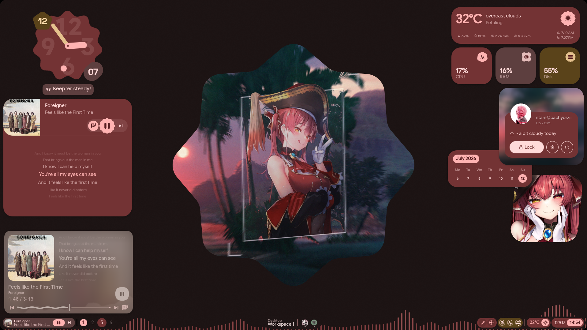
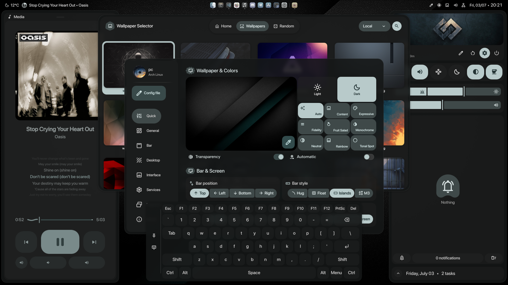
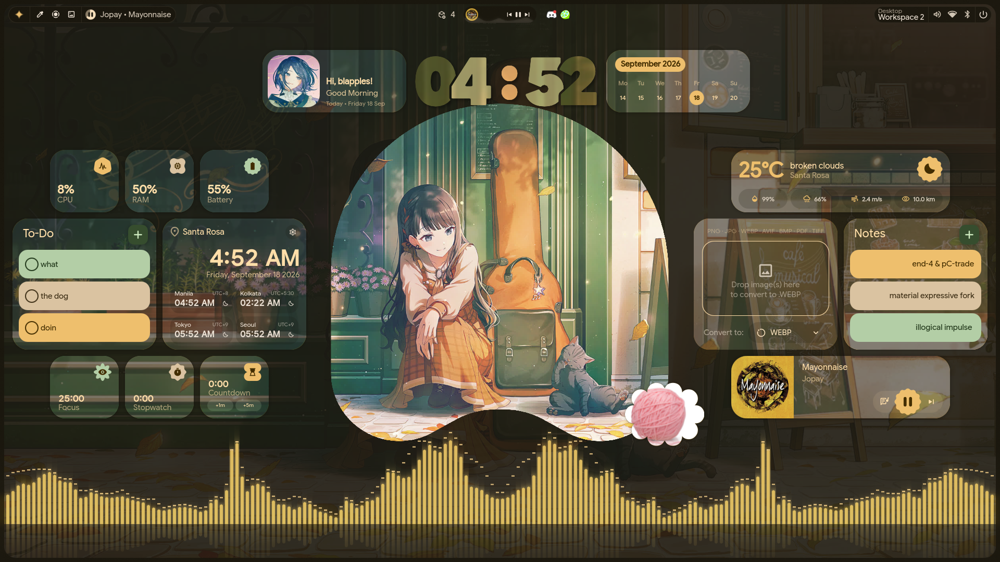
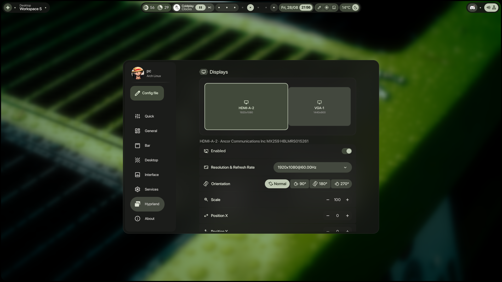

<div align="center">

# MRX Desktop

**A keyboard-driven Linux desktop environment, built around a Rust X11 window manager and Quickshell.**

[](https://github.com/manivelx/MRX-Desktop/actions/workflows/ci.yml)
[](LICENSE)
[](#platform)
[](https://www.rust-lang.org/)

[Features](#features) · [Screenshots](#screenshots) · [Installation](#installation) · [Keybindings](#keybindings) · [Documentation](#documentation) · [Contributing](#contributing)

</div>

> [!WARNING]
> **MRX is experimental software and is not ready for daily use.** The Rust window manager has a passing CI/Xvfb integration baseline, but the full Quickshell session, physical multi-monitor behavior, NVIDIA 470 / GT 740, and animation performance have not been validated. Do not replace your current desktop session with MRX or install it on a machine without a recovery path.

---

## Overview

MRX is an independent X11 desktop environment project. It combines a purpose-built **Rust window manager** with a **Quickshell/QML** desktop interface based on the supplied end4-pC X11 port.

The goal is a cohesive, keyboard-first desktop with predictable window management, monitor-local workspaces, a responsive shell, configurable settings and a reversible session. Rust owns window-management policy and runtime state; QML presents that state and provides the desktop experience.

The project is being developed for Arch Linux and CachyOS first.

## Screenshots

These are the project's included shell screenshots. They illustrate the imported/adapted shell design; they are **not a claim that the complete MRX session has passed runtime validation**.

<div align="center">
  
  
  
  
  
  
</div>

## Features

### Rust X11 window manager

- Rust-owned X11 window-management loop and authoritative state snapshot.
- Master/stack, columns and monocle layout geometry.
- Floating policy for transient and fixed-size clients.
- ICCCM-aware close requests, focus negotiation, urgency and common size hints.
- EWMH desktop metadata, client lists, fullscreen requests and initial dock-strut workareas.
- RandR monitor discovery, topology refresh and per-monitor tiling.
- Independent monitor-local workspaces and monitor-aware IPC.

### Desktop shell

- Quickshell/QML interface adapted to consume MRX monitor and window state.
- Monitor-aware workspace-bar routing.
- Initial MRX-specific compatibility adapter for supported actions.
- Upstream-derived desktop modules and assets, with unsupported compositor operations requiring further audit.

### Developer tooling

- `mrxctl` command-line IPC client.
- Versioned IPC request envelopes, request IDs and bounded socket I/O.
- Settings persistence and an isolated installer regression test.
- CI checks for formatting, tests, Clippy, builds, static checks and Xvfb integration.

## Project status

MRX is being built in phases. The implementation is real, but the feature set is not yet complete.

| Area | Current state |
|---|---|
| Rust workspace | Builds and passes unit tests in CI |
| X11 window manager | Experimental; core management path implemented |
| ICCCM/EWMH | Partial; additional state and lifecycle semantics remain |
| RandR multi-monitor | Discovery, per-monitor workspaces and Xvfb virtual-monitor coverage |
| Dock panels/workareas | Initial strut parsing and workarea application; mixed-output testing remains |
| IPC | Versioned request/reply protocol; asynchronous event streaming is in progress |
| Quickshell/QML | Adapter exists; full shell runtime is not validated |
| Graphics and animations | Renderer feasibility and animation system not implemented |
| Installer | Experimental; tested in an isolated temporary home only |
| NVIDIA 470 / GT 740 | Not tested |

See [Feature status](docs/FEATURE_STATUS.md), [Roadmap](ROADMAP.md) and [Phase 1 status](docs/PHASE-1-STATUS.md) for implementation detail and remaining acceptance criteria.

## Architecture

```text
                    Quickshell / QML
                           │
                    MRX shell adapter
                           │
                 Versioned local IPC (v2)
                           │
              ┌────────────┴────────────┐
              │                         │
        mrxctl CLI                Rust desktop core
                                        │
                                Rust X11 window manager
                                        │
                   ┌────────────────────┼────────────────────┐
                   │                    │                    │
                 ICCCM                 EWMH                 RandR
                   │                    │                    │
                   └────────────────────┼────────────────────┘
                                        │
                                      X11
```

**Design rule:** Rust is the source of truth for window state and window-management policy. QML should call the supported MRX interface rather than independently reproducing WM behavior or forwarding unsupported commands to another window manager.

## Installation

### Supported development target

- Arch Linux
- CachyOS
- X11 session
- Stable Rust toolchain

Quickshell and its required Qt/QML modules are needed for the shell. Exact dependency requirements remain under audit.

### Build from source

Clone the repository and enter it:

```bash
git clone https://github.com/manivelx/MRX-Desktop.git
cd MRX-Desktop
```

Install the currently declared Arch/CachyOS dependency set:

```bash
./install.sh --install-deps
```

Run the complete developer validation and release build:

```bash
./build.sh
```

This runs formatting, workspace tests, Clippy, debug build, static checks, Xvfb checks and a release build.

### Install user files (experimental)

After building, the user-scoped installer can copy MRX binaries, configuration, shell files and a session entry:

```bash
./install.sh
```

The installer expects Quickshell to be available and installs files under the current user's home directory. It does not automatically register MRX system-wide with SDDM. System-wide registration is deliberately an explicit manual step.

To remove the user-scoped installation:

```bash
./uninstall.sh
```

> [!CAUTION]
> The installer is not yet approved for a daily-use machine. It has isolated install/reinstall/uninstall tests, but the complete session has not been tested in a disposable VM. Review the scripts before running them. Keep your existing session and recovery path. MRX must not replace your current BSPWM, SDDM theme or Quickshell lock screen.

For manual commands and developer prerequisites, see [Building](docs/BUILDING.md) and [Testing](docs/TESTING.md).

## Keybindings

The final MRX keybinding scheme is still being developed. The repository does not yet expose a complete, validated default keybinding reference, so this README intentionally does not invent one. See the current [configuration and session sources](session/) before testing shortcuts.

## Development and testing

Run these checks individually:

```bash
cargo fmt --all -- --check
cargo test --workspace
cargo clippy --workspace --all-targets -- -D warnings
cargo build --workspace
bash ./tests/static-check.sh
bash ./tests/installer-sandbox.sh
bash ./tests/xvfb-server-check.sh
bash ./tests/xvfb-smoke.sh
```

The compiled-WM Xvfb smoke test exercises monitor discovery, independent monitor-local workspaces, dock workarea behavior, urgency and client lifecycle handling.

### Latest validation

The latest recorded full CI validation is [run #327](https://github.com/manivelx/MRX-Desktop/actions/runs/44761884015), which passed the complete workflow on commit `422615cab39c298505d49e996ce80d927e165551`. It includes formatting, workspace tests, Clippy with warnings denied, build, static checks, installer sandbox, Xvfb server probe and compiled-WM smoke test.

This is a CI result for the recorded commit, not evidence of physical hardware or complete Quickshell-session compatibility. Check [Validation](docs/VALIDATION.md) for the exact environment and limits.

## Roadmap

- **Phase 0 — Foundation:** repository, contributor docs and CI.
- **Phase 1 — X11 window manager:** ICCCM/EWMH correctness, monitor topology, layouts and workspace behavior.
- **Phase 2 — Desktop core:** typed settings, IPC event streaming, service health and recovery.
- **Phase 3 — Graphics:** capture, damage tracking, rendering and animation feasibility.
- **Phase 4 — Shell:** complete QML audit, MRX-backed actions and visual consistency.
- **Phase 5 — Release:** installer ownership/rollback, disposable-VM validation and signed releases.

The phases are not all complete. The live checklist is maintained in [ROADMAP.md](ROADMAP.md).

## Documentation

- [Architecture](docs/ARCHITECTURE.md)
- [Feature status](docs/FEATURE_STATUS.md)
- [Roadmap](ROADMAP.md)
- [Phase 1 status](docs/PHASE-1-STATUS.md)
- [Building](docs/BUILDING.md)
- [Testing](docs/TESTING.md)
- [Validation record](docs/VALIDATION.md)
- [Contributing](CONTRIBUTING.md)
- [Security policy](SECURITY.md)

## Credits and upstream

MRX's shell design and portions of its QML/assets are derived from the supplied [end-4 dots-hyprland](https://github.com/end-4/dots-hyprland) project and its X11 adaptation. Please review upstream documentation and license notices when working with imported files. MRX's Rust window manager and integration code are developed as a separate project.

## Contributing

Contributions are welcome, especially in protocol correctness, Rust architecture, tests, accessibility and shell integration.

Before opening a pull request:

1. Read [CONTRIBUTING.md](CONTRIBUTING.md).
2. Check the [roadmap](ROADMAP.md) and [feature status](docs/FEATURE_STATUS.md).
3. Include commands actually run and their results.
4. Add tests for behavior changes.
5. Clearly identify untested runtime or hardware assumptions.

## License

MRX's own repository license is MIT, subject to the licenses and notices retained with upstream-derived code and assets. See [LICENSE](LICENSE) and the relevant upstream notices.
