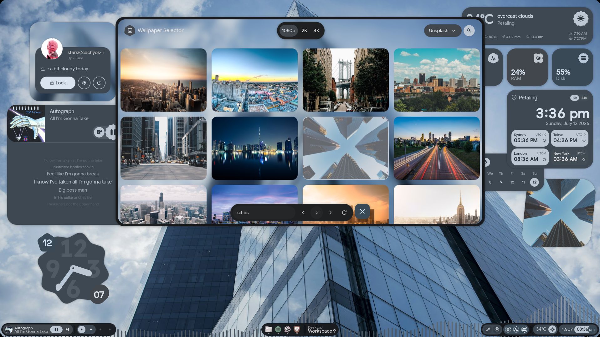
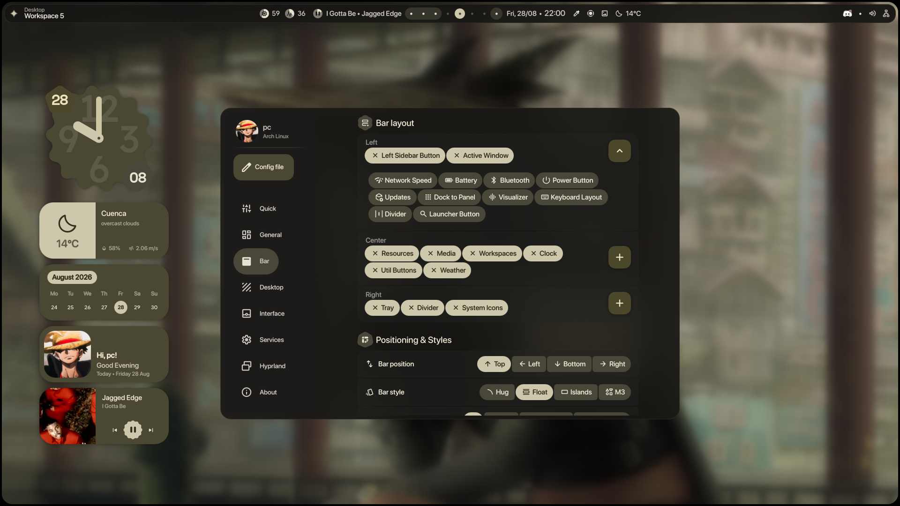

<div align="center">

# MRX Desktop

**A keyboard-driven Linux desktop environment built around a Rust X11 window manager and Quickshell.**

[](https://github.com/manivelx/MRX-Desktop/actions/workflows/ci.yml)
[](LICENSE)
[](#platform)
[](https://www.rust-lang.org/)
[](#architecture)

[Overview](#overview) · [Features](#features) · [Screenshots](#screenshots) · [Installation](#installation) · [Configuration](#configuration) · [Roadmap](#roadmap)

</div>

> [!WARNING]
> **MRX is experimental and is not ready for daily use.** The Rust window manager has an automated Xvfb integration baseline, but a complete Quickshell session, physical multi-monitor setups, NVIDIA 470 / GT 740 and graphics performance have not been validated. Do not replace your current desktop session with MRX.

---

## Overview

MRX is an independent X11 desktop environment project for Arch Linux and CachyOS. It combines a purpose-built **Rust window manager** with a **Quickshell/QML desktop shell** based on the supplied end4-pC X11 adaptation.

The goal is a keyboard-first desktop with predictable window management, monitor-local workspaces, configurable behavior and a coherent shell experience.

- **Rust owns policy:** window lifecycle, workspaces, monitor assignment, layouts and the authoritative state.
- **Quickshell owns presentation:** panels, bars, controls and desktop interaction.
- **A local IPC contract connects them:** the shell should consume MRX state instead of guessing what another window manager is doing.

The project is developed in public and in phases. Features listed below distinguish implementation from release readiness.

## Screenshots

The repository contains shell screenshots showing the imported/adapted visual direction. They are design references, not proof that the complete MRX session is runtime-validated.

<div align="center">
  
  
  
  
  
  
</div>

## Features

### Window management

- Rust-based X11 window manager with a shared, authoritative window-state model.
- Master/stack, columns and monocle layout geometry.
- Floating behavior for transient and fixed-size clients.
- ICCCM-aware polite close, focus negotiation, urgency and common size hints.
- EWMH desktop metadata, client lists and initial fullscreen/dock handling.
- Per-monitor window assignment and tiling.

### Multi-monitor and workspaces

- RandR 1.5 monitor discovery and topology refresh.
- Monitor-local active workspaces with separate state per output.
- Monitor-targeted workspace IPC and Quickshell workspace-bar routing.
- Client migration when a monitor disappears, with floating-window clamping.
- Initial EWMH dock strut/workarea support.

### Desktop shell

- Quickshell/QML interface adapted from the supplied end4-pC X11 port.
- MRX-specific backend for monitor, workspace and window information.
- Compatibility dispatch for a limited, explicit set of supported actions.
- Imported upstream modules remain under audit; unsupported compositor actions are not claimed as implemented.

### Developer experience

- `mrxctl` command-line client.
- Versioned local IPC (v3) with request IDs, bounded socket I/O and persistent snapshot subscriptions (`mrxctl subscribe`).
- Typed settings with candidate validation and atomic persistence, plus developer build helpers.
- Automated formatting, tests, Clippy, build, installer sandbox and Xvfb integration.

## Project status

MRX is not a finished desktop environment yet. The table reflects the implementation status rather than marketing completion.

| Component | Status |
|---|---|
| Rust workspace | Builds and passes tests in the recorded CI baseline |
| X11 window manager | Core path implemented; experimental |
| ICCCM/EWMH | Partial; maximize/restore, above/below and full hidden-state semantics remain |
| RandR | Discovery, topology refresh and virtual-monitor Xvfb coverage |
| Per-monitor workspaces | Implemented with monitor-aware IPC and shell routing |
| Dock workareas | Initial partial/legacy strut support; complex panel geometry remains |
| IPC | Protocol v3 request/reply plus persistent change-only snapshot subscriptions; async operation results and health reporting remain |
| Quickshell/QML | MRX adapter exists; complete shell runtime is unverified |
| Graphics/animations | Renderer and workspace animations are future phases |
| Installer | Experimental; isolated temporary-home regression tests only |
| NVIDIA 470 / GT 740 | Not tested |

See [Feature status](docs/FEATURE_STATUS.md), [Phase 1 status](docs/PHASE-1-STATUS.md), [Validation](docs/VALIDATION.md) and the [Roadmap](ROADMAP.md).

## Architecture

```text
                    Quickshell / QML
                           │
                    MRX shell adapter
                           │
                  Versioned local IPC
                           │
              ┌────────────┴────────────┐
              │                         │
           mrxctl                 Rust desktop core
                                        │
                                Rust X11 window manager
                                        │
                   ┌────────────────────┼────────────────────┐
                   │                    │                    │
                 ICCCM                 EWMH                 RandR
                   │                    │                    │
                   └────────────────────┼────────────────────┘
                                        │
                                      X11
```

**Design principle:** Rust is the source of truth for window state and window-management policy. QML presents state and sends supported actions through the MRX API. It must not silently issue compositor-specific commands that MRX does not implement.

## Installation

### Platform

The initial development target is:

- Arch Linux
- CachyOS
- X11
- Stable Rust toolchain
- Quickshell and required Qt/QML modules for the shell

Other distributions, Wayland sessions and GPU configurations are not currently supported claims.

### Build from source

Clone the repository:

```bash
git clone https://github.com/manivelx/MRX-Desktop.git
cd MRX-Desktop
```

Install the declared Arch/CachyOS development dependencies:

```bash
./install.sh --install-deps
```

Run the complete developer build and validation suite:

```bash
./build.sh
```

The build helper runs formatting, workspace tests, Clippy, build checks, static checks and Xvfb tests. See [Building](docs/BUILDING.md) for the supported commands and prerequisites.

### Experimental user install

After reviewing the scripts and building successfully:

```bash
./install.sh
```

Remove the user-scoped installation with:

```bash
./uninstall.sh
```

> [!CAUTION]
> The installer is still experimental. Its sandbox test uses a temporary home directory; it is not a disposable Arch/CachyOS VM test. Do not use it on your daily driver yet. Keep your current BSPWM session, SDDM theme, Quickshell lock screen and a known recovery path untouched. System-wide session registration is deliberately not automatic.

## Configuration

MRX reads its own configuration and settings. The live settings surface is still being expanded; not every imported shell setting is backed by a working MRX runtime option.

Useful places to start:

- `config/` — default configuration.
- `session/` — session launcher and desktop entry.
- `shell/services/MRXBackend.qml` — shell-to-WM adapter.
- `docs/BUILDING.md` — build and dependency guidance.

The keybinding viewer is integrated for the MRX/X11 session where the source configuration is available. Imported end4/Hyprland shortcuts should not be assumed to map one-to-one to MRX capabilities.

## Development and testing

The automated checks can also be run independently:

```bash
cargo fmt --all -- --check
cargo test --workspace
cargo clippy --workspace --all-targets -- -D warnings
cargo build --workspace
bash ./tests/static-check.sh
bash ./tests/installer-sandbox.sh
bash ./tests/xvfb-server-check.sh
bash ./tests/xvfb-smoke.sh
```

The compiled-WM Xvfb smoke test exercises virtual RandR monitors, monitor-local workspace switching, EWMH dock workareas, dock focus behavior, ICCCM urgency and client lifecycle behavior.

### Latest CI baseline

The merged `main` commit passed [GitHub Actions run #403](https://github.com/manivelx/MRX-Desktop/actions/runs/44765939899) on commit `579dacb6f099726621583fa034b88d9d9df40b28`. The full workflow passed formatting, workspace tests, Clippy with warnings denied, build, static checks, installer sandbox and the compiled-WM Xvfb smoke test.

That CI result validates the automated software test suite, not a complete Quickshell session or physical hardware. Check [Validation](docs/VALIDATION.md) for details and limitations.

## Roadmap

- **Phase 0 — Foundation:** repository, contributor documentation and CI.
- **Phase 1 — Window manager:** ICCCM/EWMH correctness, RandR, workspaces, layouts and real-client validation.
- **Phase 2 — Desktop core:** IPC events, typed settings, health and recovery.
- **Phase 3 — Graphics:** capture, damage tracking, renderer and workspace animation feasibility.
- **Phase 4 — Shell:** complete QML audit, MRX-backed actions, accessibility and visual consistency.
- **Phase 5 — Release:** installer/rollback, VM validation, diagnostics and reproducible artifacts.

Follow the live checklists in [ROADMAP.md](ROADMAP.md). The phases are deliberately not marked complete until their acceptance criteria have evidence.

## Documentation

- [Architecture](docs/ARCHITECTURE.md)
- [Feature status](docs/FEATURE_STATUS.md)
- [Roadmap](ROADMAP.md)
- [Phase 1 status](docs/PHASE-1-STATUS.md)
- [Building](docs/BUILDING.md)
- [Testing](docs/TESTING.md)
- [Validation record](docs/VALIDATION.md)
- [Contributing](CONTRIBUTING.md)
- [Security policy](SECURITY.md)

## Credits and upstream

The shell design and some QML modules/assets are derived from the supplied [end-4 dots-hyprland](https://github.com/end-4/dots-hyprland) project and its X11 adaptation. Preserve the upstream license and attribution notices when modifying imported files. The MRX Rust window manager and integration layers are developed separately.

## Contributing

Contributions are welcome in Rust/X11 protocol correctness, IPC, testing, accessibility, QML integration and documentation.

1. Read [CONTRIBUTING.md](CONTRIBUTING.md).
2. Check the [Roadmap](ROADMAP.md) and [Feature status](docs/FEATURE_STATUS.md).
3. Include the exact commands run and their outputs.
4. Add tests for behavioral changes.
5. Clearly state any runtime or hardware assumptions that remain untested.

## License

MRX's own repository license is MIT, subject to the licenses and notices retained with upstream-derived code and assets. See [LICENSE](LICENSE) and the retained upstream notices.
